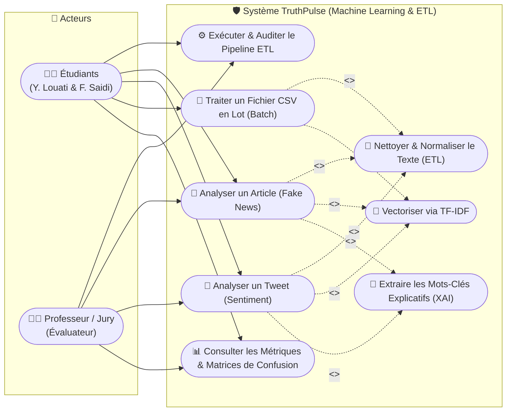
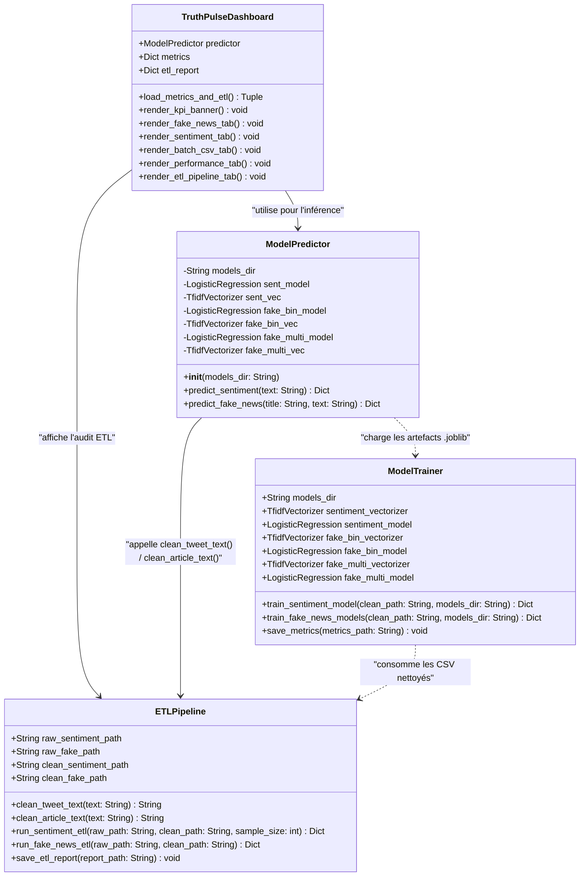
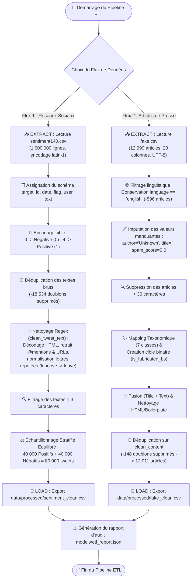
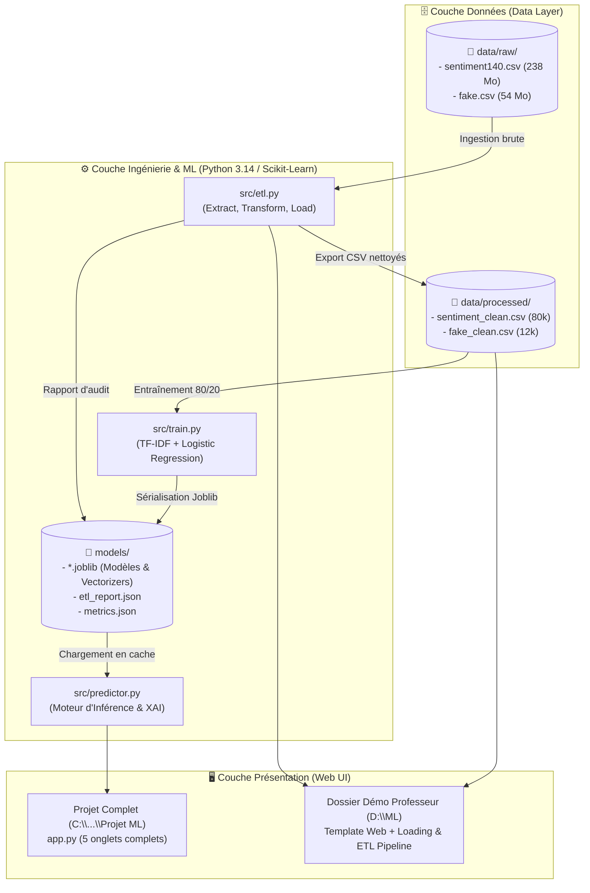

# 📘 Cahier des Charges — Projet Académique Machine Learning (4 DSIA)

**Intitulé du Projet :** **TruthPulse : Plateforme Intelligente de Détection de Désinformation (Fake News) & d'Analyse de Sentiments sur les Réseaux Sociaux**  
**Réalisé par :** **Y. Louati** & **F. Saidi**  
**Niveau / Filière :** 4ème année Data Science & Intelligence Artificielle (**4 DSIA**)  
**Année Universitaire :** 2025 / 2026  

---

## 1. Cadre Général et Contexte du Projet

### 1.1 Contexte et Problématique
Avec l'explosion exponentielle des contenus générés par les utilisateurs sur les réseaux sociaux et la multiplication des sources d'information en ligne, deux défis majeurs émergent dans l'écosystème numérique contemporain :
1. **La prolifération de la désinformation (Fake News) :** La diffusion rapide d'articles fabriqués, de théories du complot, de propagande ou de contenus fortement biaisés compromet la fiabilité de l'information publique.
2. **La volatilité de l'opinion publique (Analyse de Sentiments) :** Les flux massifs de publications courtes (tweets, commentaires) contiennent énormément de bruit syntaxique (`@mentions`, liens URL, entités HTML, abréviations, répétitions de lettres comme `sooooo goooood`), rendant l'extraction de la polarité émotionnelle complexe à grande échelle.

### 1.2 Objectifs du Projet
Le projet **TruthPulse**, développé par **Y. Louati** et **F. Saidi**, vise à concevoir et déployer une solution complète de **Data Engineering (ETL)** et de **Machine Learning (NLP)** permettant de :
- **Ingérer et nettoyer (Pipeline ETL)** deux corpus massifs et hétérogènes totalisant plus de **1,61 million d'enregistrements bruts** (`Sentiment140` et `Fake News Corpus`).
- **Entraîner des modèles prédictifs performants et explicables** basés sur la vectorisation **TF-IDF** (unigrammes et bigrammes) couplée à des classifieurs de **Régression Logistique** calibrés.
- **Fournir une explicabilité au niveau des mots (Explainable AI - XAI)** en extrayant directement l'impact pondéré des tokens (coefficients du modèle $\times$ poids TF-IDF).
- **Exposer les fonctionnalités via une application Web interactive** (tableau de bord Streamlit / Template HTML) permettant l'analyse en temps réel, le traitement par lots (Batch CSV) et l'audit du pipeline ETL.

### 1.3 Répartition des Rôles (Équipe 4 DSIA)
| Membre de l'équipe | Responsabilités Principales | Modules Référents |
| :--- | :--- | :--- |
| **Y. Louati** | Architecture Data Engineering (Pipeline ETL), Prétraitement NLP, Modélisation Fake News (Binaire & Taxonomie Multi-classes), Intégration Dashboard | `src/etl.py`, `src/train.py`, `app.py` |
| **F. Saidi** | Exploration et Profilage des Données (EDA), Modélisation Analyse de Sentiments, Moteur d'Inférence & Explicabilité (XAI), Interface Web & Tests Batch | `src/analyze_datasets.py`, `src/predictor.py`, `app.py` |

---

## 2. Spécifications des Données et Pipeline ETL

### 2.1 Corpus 1 : Analyse de Sentiments (`Sentiment140`)
- **Source brute :** `data/raw/sentiment140.csv` (**238 Mo**, **1 600 000 tweets** sans en-tête natif).
- **Étapes ETL (`run_sentiment_etl`) :**
  1. **Extract :** Lecture en encodage `latin-1` et assignation du schéma canonique `[target, id, date, flag, user, text]`.
  2. **Transform :**
     - Suppression des métadonnées non pertinentes (`id`, `flag`, `user`).
     - Ré-encodage de la cible : `0` $\rightarrow$ `0` (*Negative*) et `4` $\rightarrow$ `1` (*Positive*).
     - Déduplication stricte sur le texte brut (**18 534 doublons supprimés**).
     - Nettoyage NLP par expressions régulières (`clean_tweet_text`) : décodage des entités HTML (`&amp;`, `&quot;`), suppression des URLs (`http://...`), suppression des mentions (`@username`), normalisation des répétitions de caractères (`looooove` $\rightarrow$ `loove`), conservation de la ponctuation expressive (`!`, `?`).
     - Échantillonnage stratifié équilibré : sélection aléatoire contrôlée (`random_state=42`) de **80 000 tweets** (**40 000 Positifs** / **40 000 Négatifs**).
     - Ingénierie de variables : calcul de `char_count` et `word_count` (moyenne : **12,71 mots/tweet**).
  3. **Load :** Sauvegarde dans `data/processed/sentiment_clean.csv`.

### 2.2 Corpus 2 : Détection de Fake News & Désinformation (`fake.csv`)
- **Source brute :** `data/raw/fake.csv` (**54 Mo**, **12 999 articles**, **20 attributs**).
- **Étapes ETL (`run_fake_news_etl`) :**
  1. **Extract :** Lecture UTF-8 des 12 999 articles journalistiques et métadonnées associées (`uuid`, `author`, `title`, `text`, `language`, `type`, `spam_score`, etc.).
  2. **Transform :**
     - Filtrage linguistique : conservation exclusive des articles en anglais (**596 articles non-anglais écartés**).
     - Imputation des valeurs manquantes : remplacement des auteurs manquants par `'Unknown'` (2 424 cas), titres vides par `''` (680 cas) et normalisation de `spam_score`.
     - Filtrage qualitatif : suppression des articles vides ou tronqués (`< 30 caractères`).
     - Harmonisation taxonomique : regroupement de la colonne `type` en **7 catégories académiques** (*Fabricated / BS*, *Extreme Bias*, *Conspiracy Theory*, *Hate Speech*, *State Propaganda*, *Junk Science*, *Satire*) + création de la cible binaire `is_fabricated_bs` (`1` pour *Fabricated/BS/JunkSci*, `0` sinon).
     - Fusion et nettoyage (`clean_article_text`) : concaténation `title + text`, suppression des balises HTML et des bandeaux publicitaires/réseaux sociaux (*"Share on Facebook"*, *"CLICK HERE TO SUBSCRIBE"*, etc.).
     - Déduplication : suppression de **148 articles dupliqués**.
  3. **Load :** Sauvegarde des **12 011 articles nettoyés** (moyenne : **666,27 mots/article**) dans `data/processed/fake_clean.csv`.

---

## 3. Spécifications Fonctionnelles et Non-Fonctionnelles

### 3.1 Besoins Fonctionnels (BF)
- **BF1 — Exécution et Audit du Pipeline ETL :** Charger les fichiers bruts, appliquer les transformations NLP, générer les datasets nettoyés et visualiser les statistiques avant/après nettoyage.
- **BF2 — Détection de Fake News (Double Niveau) :**
  - *Niveau 1 (Binaire) :* Déterminer si un article est une fabrication pure (*Fabricated / Fake*) ou un contenu biaisé/satirique/conspirationniste, avec score de probabilité.
  - *Niveau 2 (Multi-classes) :* Classifier l'article selon les 7 catégories de la taxonomie de désinformation et afficher la distribution des probabilités.
- **BF3 — Analyse de Sentiments Réseaux Sociaux :** Prédire la polarité (*Positive* vs *Negative*) d'un tweet ou commentaire, afficher le texte nettoyé par l'ETL et les probabilités associées.
- **BF4 — Explicabilité des Prédictions (XAI) :** Afficher pour chaque prédiction les mots-clés déclencheurs (*Trigger Keywords* / *Influential Words*) avec leur poids directionnel.
- **BF5 — Traitement par Lots (Batch CSV) :** Permettre le téléversement d'un fichier `.csv`, appliquer le modèle choisi sur une colonne textuelle et exporter le fichier annoté.
- **BF6 — Tableau de Bord des Performances :** Visualiser les métriques d'évaluation (Accuracy, Précision, Rappel, F1-Score) et les matrices de confusion.

### 3.2 Besoins Non-Fonctionnels (BNF)
- **BNF1 — Temps de réponse (Latence) :** Temps d'inférence unitaire inférieur à **15 ms** grâce à la mise en cache des modèles (`@st.cache_resource`) et la vectorisation creuse SciPy.
- **BNF2 — Modularité et Maintenabilité :** Séparation stricte en couches (`src/etl.py` pour les données, `src/train.py` pour l'apprentissage, `src/predictor.py` pour l'inférence, `app.py` pour l'IHM).
- **BNF3 — Ergonomie et Design :** Interface moderne en mode sombre (*Glassmorphism*), responsive, avec cas de test pré-chargés en un clic pour faciliter la démonstration devant le jury.
- **BNF4 — Reproductibilité :** Fixation systématique des graines aléatoires (`random_state=42`) lors de l'échantillonnage ETL et du découpage Train/Test (80% / 20% stratifié).

---

## 4. Modélisation UML du Système

### 4.1 Diagramme de Cas d'Utilisation (Use Case Diagram)

---

### 4.2 Diagramme de Classes (Class Diagram)

---

### 4.3 Diagramme de Séquence — Pipeline ETL & Inférence (Sequence Diagram)

```mermaid
sequenceDiagram
    autonumber
    actor Acteur as 👨‍🏫 Professeur / Étudiant
    participant UI as 🖥️ Interface Web (Dashboard / HTML)
    participant ETL as ⚙️ Module ETL (src/etl.py)
    participant Pred as 🧠 ModelPredictor (src/predictor.py)
    participant Artifacts as 💾 Artefacts (.joblib & .json)

    rect rgb(30, 41, 59)
        Note over Acteur, Artifacts: Phase 1 : Chargement & Audit du Pipeline ETL
        Acteur->>UI: Consulte l'onglet "ETL Engineering Pipeline"
        UI->>ETL: Exécute / Lit l'état du chargement ETL
        ETL->>ETL: Extract (fake.csv 12 999 lignes / sentiment140 1.6M lignes)
        ETL->>ETL: Transform (Filtrage langue, Regex NLP, Déduplication, Stratification)
        ETL->>Artifacts: Load (Génère fake_clean.csv, sentiment_clean.csv & etl_report.json)
        Artifacts-->>UI: Retourne les statistiques et échantillons avant/après
        UI-->>Acteur: Affiche les KPIs ETL, tableaux comparatifs et distributions
    end

    rect rgb(35, 30, 55)
        Note over Acteur, Artifacts: Phase 2 : Inférence Temps Réel & Explicabilité (XAI)
        Acteur->>UI: Saisit un article ou tweet et clique sur "Analyser"
        UI->>Pred: predict_fake_news(title, text) ou predict_sentiment(text)
        Pred->>ETL: clean_article_text() ou clean_tweet_text()
        ETL-->>Pred: Texte nettoyé et normalisé
        Pred->>Artifacts: Transforme via TfidfVectorizer & prédit via LogisticRegression
        Artifacts-->>Pred: Probabilités des classes + Coefficients des tokens actifs
        Pred-->>UI: Dictionnaire JSON (verdict, confiance, taxonomie, mots déclencheurs)
        UI-->>Acteur: Affiche le badge de verdict, jauges et mots explicatifs
    end
```

---

### 4.4 Diagramme d'Activité — Processus de Transformation ETL (Activity Diagram)

---

### 4.5 Diagramme d'Architecture et de Déploiement (Component Diagram)

---

## 5. Résultats Expérimentaux et Performances des Modèles

| Modèle / Tâche | Algorithme & Vectorisation | Jeu de Test | Accuracy | Précision | Rappel | F1-Score |
| :--- | :--- | :---: | :---: | :---: | :---: | :---: |
| **1. Analyse de Sentiments** | Logistic Regression ($C=2.0$) + TF-IDF (30k 1-2 ngrams) | 16 000 tweets | **78,89 %** | 78,83 % | 79,00 % | **78,92 %** |
| **2. Détection Fake News (Binaire)** | Balanced Logistic Regression + TF-IDF (25k 1-2 ngrams) | 2 403 articles | **88,68 %** | 89,75 % | 88,68 % | **89,15 %** |
| **3. Taxonomie Désinformation (7 classes)** | Multi-Class Balanced Logistic Regression + TF-IDF (20k) | 2 403 articles | **85,02 %** | — | — | **86,88 %** |

---

## 6. Environnement Technique et Livrables

- **Langage :** Python 3.14
- **Manipulation de données & ETL :** `pandas`, `numpy`, `re`, `html`, `json`
- **Machine Learning & NLP :** `scikit-learn` (`TfidfVectorizer`, `LogisticRegression`, `train_test_split`), `joblib`
- **Visualisation & Interface Web :** `streamlit`, `matplotlib`, `seaborn`, HTML5 / CSS3 (*Glassmorphism UI*)

